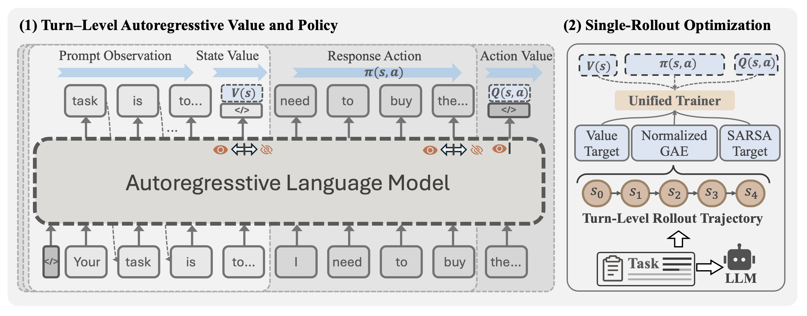
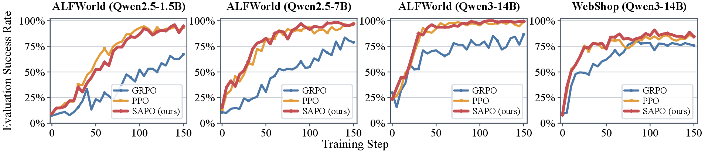
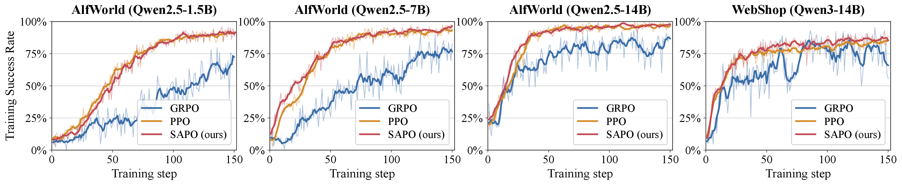
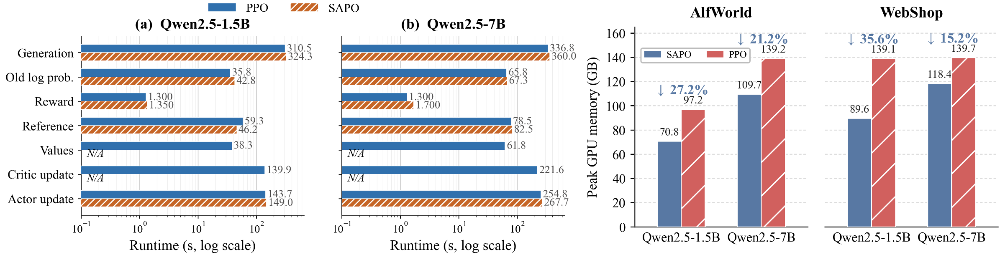

<h2 align="center">
  SAPO: Single-Rollout Autoregressive Policy Optimization<br>
  for Agentic Reinforcement Learning
</h2>

<p align="center">
  <a href="https://github.com/dy-liang/SAPO">
    
  <a href="https://arxiv.org/abs/2608.19842">
  
  <a >
    </a>


<p align="center">
  <b>Dayang Liang<sup>†</sup>, Lang Feng<sup>†</sup>, Bo An, Yunlong Liu</b><br>
  <sup>†</sup>Equal contribution &nbsp;&nbsp;
</p>

`SAPO` is a compute- and memory-efficient **PPO-style framework** designed for long-horizon LLM agentic training. By learning the policy and value functions within a single causal language model, `SAPO` entirely eliminates PPO's separate critic model and the multiple rollouts typically required by group-relative methods. Consequently, with identical sampling budgets, **`SAPO` matches PPO's performance** and substantially outperforms GRPO, while achieving a **significant reduction in resource consumption.**

<p align="center">
  
</p>

<p align="center"><i>Overview of SAPO.</i></p>

## Quick Feature Summary

| Feature Category | SAPO Capabilities |
|:--|:--|
| **Optimization** | ✅ PPO-style policy optimization with explicit value learning<br> ✅ No separate critic model or value head<br>✅ No same-task rollout groups required <br>✅ Turn-level generalized advantage estimation<br>✅ Auxiliary on-policy SARSA action-value targets |
| **Stability** | ✅ Value-target scaling<br>✅ Advantage normalization<br>✅ Double logits-based Value |
| **Environment Stack** | ✅ ALFWorld <br>✅ WebShop<br>🧪 Others in testing|
| **Evaluated Backbones** | ✅ Qwen2.5-1.5B-Instruct<br>✅ Qwen2.5-7B-Instruct<br>✅ Qwen3-14B-Instruct<br>✅ Qwen3-A3B-32B (MoE)<br>🧪 Others in testing |
| **Measured Efficiency** | ✅ Consistent performance than PPO <br>✅ 24.8% lower average peak GPU memory than PPO<br>✅ 23.1% lower average per-iteration runtime than PPO |

## Main Results

We evaluate SAPO on **ALFWorld** and **WebShop** with Qwen2.5-1.5B/7B-Instruct and Qwen3-14B-Instruct. **`To ensure a fair comparison, we configure all methods with identical parallel settings and sampling budgets for the tasks.`** All RL results are reported as mean ± standard deviation over three random seeds. **Bold** denotes the best result and <u>underline</u> denotes the second-best result within each backbone.

<table border="1" cellspacing="0" cellpadding="6" width="100%">
  <thead>
    <tr>
      <th rowspan="2" align="center">Backbone</th>
      <th rowspan="2" align="center">Method</th>
      <th align="center">ALFWorld</th>
      <th colspan="2" align="center">WebShop</th>
    </tr>
    <tr>
      <th align="center">Success (%) ↑</th>
      <th align="center">Score ↑</th>
      <th align="center">Success (%) ↑</th>
    </tr>
  </thead>
  <tbody>
    <tr>
      <td rowspan="3" align="center"><b>Qwen2.5<br>1.5B</b></td>
      <td align="center">GRPO</td>
      <td align="center">72.8 ± 3.6</td>
      <td align="center">75.8 ± 3.5</td>
      <td align="center">56.8 ± 3.8</td>
    </tr>
    <tr>
      <td align="center">PPO</td>
      <td align="center"><u>93.0 ± 1.1</u></td>
      <td align="center"><b>82.7 ± 1.2</b></td>
      <td align="center"><u>65.6 ± 2.7</u></td>
    </tr>
    <tr>
      <td align="center"><b>SAPO (Ours)</b></td>
      <td align="center"><b>94.6 ± 1.4</b></td>
      <td align="center"><u>80.1 ± 2.1</u></td>
      <td align="center"><b>66.0 ± 1.5</b></td>
    </tr>
    <tr>
      <td rowspan="3" align="center"><b>Qwen2.5<br>7B</b></td>
      <td align="center">GRPO</td>
      <td align="center">77.6 ± 5.2</td>
      <td align="center">79.3 ± 2.8</td>
      <td align="center">66.1 ± 3.7</td>
    </tr>
    <tr>
      <td align="center">PPO</td>
      <td align="center"><u>95.8 ± 1.2</u></td>
      <td align="center"><u>87.7 ± 1.8</u></td>
      <td align="center"><u>82.3 ± 2.2</u></td>
    </tr>
    <tr>
      <td align="center"><b>SAPO (Ours)</b></td>
      <td align="center"><b>96.1 ± 1.1</b></td>
      <td align="center"><b>88.4 ± 1.7</b></td>
      <td align="center"><b>83.6 ± 1.9</b></td>
    </tr>
    <tr>
      <td rowspan="3" align="center"><b>Qwen3<br>14B</b></td>
      <td align="center">GRPO</td>
      <td align="center">83.8 ± 8.6</td>
      <td align="center">85.0 ± 6.1</td>
      <td align="center">77.2 ± 6.6</td>
    </tr>
    <tr>
      <td align="center">PPO</td>
      <td align="center"><u>97.9 ± 2.3</u></td>
      <td align="center"><b>92.4 ± 1.5</b></td>
      <td align="center"><b>84.8 ± 1.8</b></td>
    </tr>
    <tr>
      <td align="center"><b>SAPO (Ours)</b></td>
      <td align="center"><b>98.7 ± 0.5</b></td>
      <td align="center"><u>90.0 ± 1.3</u></td>
      <td align="center"><u>84.4 ± 0.8</u></td>
    </tr>
  </tbody>
</table>

**Takeaway.** Across all three model scales, SAPO closely matches PPO and consistently outperforms GRPO. At 7B, SAPO reaches **96.1%** ALFWorld success and an **88.4 / 83.6%** WebShop score/success rate, leading PPO and GRPO under the matched protocol. These results are obtained with the environments' default sparse outcome rewards, without task-specific dense reward shaping.

### Evaluation Curves & Training Curves
SAPO follows PPO-like learning dynamics across model scales, while **GRPO generally converges more slowly and exhibits a lower final success rate**. Also, SAPO maintains PPO-level performance with **lower variation than GRPO**, demonstrating that sharing policy and value learning in one model preserves stable PPO-like optimization behavior.
<p align="center">
  
</p>
<p align="center">
  
</p>

## Resource Efficiency
Under matched batch sizes and sampling budgets on NVIDIA H200 GPUs, SAPO reduces average peak memory by **24.8%** and average per-iteration runtime by **23.1%** relative to PPO.

<p align="center">
  
</p>

| Resource setting | PPO | SAPO | Reduction |
|:--|--:|--:|--:|
| ALFWorld, 1.5B — runtime / iteration | ≈728.8 s | ≈563.7 s | **↓ 22.6%** |
| ALFWorld, 7B — runtime / iteration | ≈1020.6 s | ≈779.2 s | **↓ 23.6%** |
| ALFWorld, 1.5B — peak GPU memory | 97.2 GB | 70.8 GB | **↓ 27.2%** |
| ALFWorld, 7B — peak GPU memory | 139.2 GB | 109.7 GB | **↓ 21.2%** |
| WebShop, 1.5B — peak GPU memory | 139.1 GB | 89.6 GB | **↓ 35.6%** |
| WebShop, 7B — peak GPU memory | 139.7 GB | 118.4 GB | **↓ 15.2%** |

## Installation

SAPO is implemented on top of [verl-agent](https://github.com/langfengq/verl-agent), which extends [veRL](https://github.com/volcengine/verl) for multi-turn agent–environment interaction. We recommend a separate Conda environment for each task environment to avoid dependency conflicts.

### 1. Core SAPO / veRL environment

```bash
git clone https://github.com/dy-liang/SAPO.git
cd SAPO

conda create -n sapo python=3.12 -y
conda activate sapo

pip3 install vllm==0.11.0
pip3 install flash-attn==2.7.4.post1 --no-build-isolation --no-cache-dir
pip install -e .
```

### 2. ALFWorld

```bash
conda activate sapo
pip3 install gymnasium==0.29.1
pip3 install stable-baselines3==2.6.0
pip install alfworld

# Download PDDL/game files and the pretrained Mask R-CNN detector.
alfworld-download -f

# Optional installation check.
alfworld-play-tw
```

Use `alfworld-download -f --extra` if you also need the pretrained checkpoints and sequence-to-sequence data.

### 3. WebShop

WebShop requires Python 3.10 or earlier, so install it in a dedicated environment:

```bash
conda create -n sapo-webshop python=3.10 -y
conda activate sapo-webshop

cd agent_system/environments/env_package/webshop/webshop
./setup.sh -d all

# Return to the SAPO repository root.
cd /path/to/SAPO
pip3 install torch==2.6.0 --index-url https://download.pytorch.org/whl/cu124
pip3 install flash-attn==2.7.4.post1 --no-build-isolation
pip3 install -e .
pip3 install vllm==0.8.2
```

If `gdown` cannot fetch the WebShop assets, configure the Google Drive cookie at `.cache/gdown/cookies.txt` or download the files manually.

### 4. AppWorld (experimental)

Install the client integration in the SAPO environment:

```bash
conda activate sapo
pip install git+https://github.com/StonyBrookNLP/appworld.git
appworld install
pip install -e .
```

Run the AppWorld server from a separate environment:

```bash
conda create -n appworld python=3.12 -y
conda activate appworld
pip install git+https://github.com/StonyBrookNLP/appworld.git
appworld install
appworld download data
```

> AppWorld is supported by the underlying `verl-agent` environment stack, but it is not part of the SAPO experiments reported above.

## Examples

The launch scripts follow the `verl-agent` convention. Update model paths, GPU allocation, and environment-specific data paths in the corresponding shell script before launching a run.

### SAPO

SAPO uses one rollout per task and learns policy and value in a shared model update.

```bash
bash examples/sapo_trainer/run_alfworld.sh  # ALFWorld
bash examples/sapo_trainer/run_webshop.sh   # WebShop
```

### PPO

The PPO baseline uses a separate critic and the same turn-level GAE and matched sampling budget used in the paper.

```bash
bash examples/ppo_trainer/run_alfworld.sh  # ALFWorld
bash examples/ppo_trainer/run_webshop.sh   # WebShop
```

### Implementation Flow

1. **Parallel rollout:** sample one trajectory for each task with the current policy.
2. **Shared evaluation:** obtain token log-probabilities together with $V(s_t)$ and $Q(s_t,a_t)$ from the pre- and post-action causal boundaries.
3. **Turn-level targets:** compute GAE advantages, $\lambda$-return state-value targets, and on-policy SARSA action-value targets.
4. **Joint update:** optimize the clipped policy loss, value loss, and auxiliary action-value loss in one shared-model update.
5. **Evaluation and checkpointing:** periodically evaluate success rate, save checkpoints, and retain the best validation model.

## Citation

If SAPO is useful in your research, please cite:

```bibtex
@misc{liang2026sapo,
      title={SAPO: Single-Rollout Autoregressive Policy Optimization for Agentic Reinforcement Learning}, 
      author={Dayang Liang, Lang Feng, Bo An and Yunlong Liu},
      year={2026},
      eprint={2608.19842},
      archivePrefix={arXiv},
      url={https://arxiv.org/abs/2608.19842}, 
}
```

## Acknowledgements

This project is built on [verl-agent](https://github.com/langfengq/verl-agent) and [veRL](https://github.com/volcengine/verl). We thank the authors and maintainers of these projects, as well as the ALFWorld, WebShop, and AppWorld multi-turn LLM communities.
